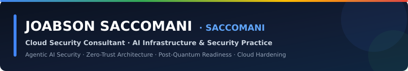
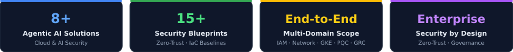

  

I help organizations turn cloud security into an enabler for innovation — not a bottleneck. Beyond flagging risks, I roll up my sleeves to design and build practical, automated, and **agentic AI security** solutions at enterprise scale.

  

---

## Tech Stack & Security Toolkit

  
  
  
  
  
  

  
  
  
  
  
  

  
  
  
  
  
  

---

## Core Security Pillars

* **Agentic AI Security Automation:** Leveraging autonomous AI workflows to accelerate posture assessments and security engineering.
* **Zero-Trust Cloud Architecture:** Designing least-privilege identity, network perimeter, container, and workload defenses at scale.
* **AI & API Runtime Defense:** Securing generative AI applications, APIs, and sensitive data across enterprise cloud environments.
* **Quantum & Compliance Readiness:** Supporting Post-Quantum Cryptography (PQC) strategy, regulatory alignment, and modern SecOps.

---

## Projects & Security Portfolio

> [!NOTE]
> All project repositories are currently **private**. Reach out on [LinkedIn](https://linkedin.com/in/jsaccomani) to connect, exchange ideas, or discuss any of these areas.

### Agentic AI Security Initiatives

| Initiative | Focus |
| :--- | :--- |
| **Agentic PQC** | Enterprise cryptographic visibility and Post-Quantum Cryptography (PQC) readiness. |
| **Agentic IAM** | Cloud identity posture assessment and least-privilege modernization. |
| **Agentic VPC** | Cloud network architecture review and Zero-Trust perimeter hardening. |
| **Agentic GKE** | Kubernetes security posture assessment and hardened cluster governance. |
| **Agentic GRC** | AI-assisted compliance readiness and cloud governance support. |
| **Agentic AISPR** | Enterprise AI & LLM security posture review and governance. |
| **Agentic CSPR** | End-to-end Cloud Security Posture Review and remediation strategy. |
| **MAEGOR** | Conversational Cyber Threat Intelligence (CTI) and defensive SecOps support. |

### Security Blueprints & Tooling

| Initiative | Focus |
| :--- | :--- |
| **Model Armor** | Runtime security guardrails and data protection patterns for generative AI workloads. |
| **ApiSPR** | Enterprise API security posture assessment and edge defense blueprints. |
| **Cloud SecOps** | Detection engineering foundations, SIEM/SOAR architecture, and security operations automation. |
| **Cloud & Hybrid Hardening** | Zero-Trust security baselines for Kubernetes, VMware Engine, and core cloud environments. |
| **Workspace DLP as Code** | Policy-as-code workflows for enterprise Data Loss Prevention. |
| **Multi-Cloud Posture Engine** | Automated security discovery and compliance baseline reporting across clouds. |
| **AppSec & Red Teaming Suite** | Automated application and infrastructure security assessment toolkit. |

---

## Frameworks & Standards

  
  
  
  
  
  
  
  

---

## Beyond the Code

* **Leading Christian Googlers Brasil:** Fostering community, support, and shared values across Brazil.
* **Learning Ambassadors:** Mentoring teams and sharing study paths across Cloud Security and Generative AI.
* **Off the Clock:** Amateur cook experimenting with new recipes in the kitchen, always with a great playlist running in the background.

---

## Let’s Connect

  
  

  Always open to talking AI, Cloud Security, or swapping a great recipe.

